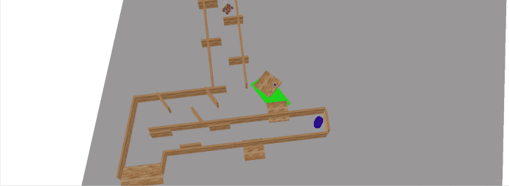
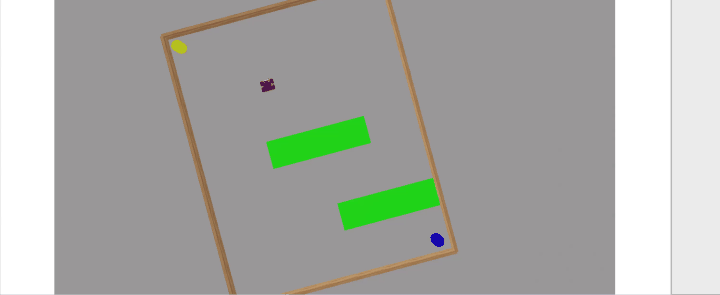
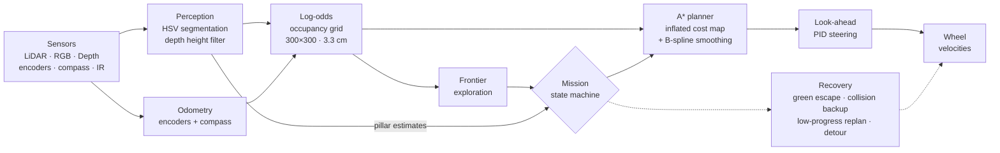
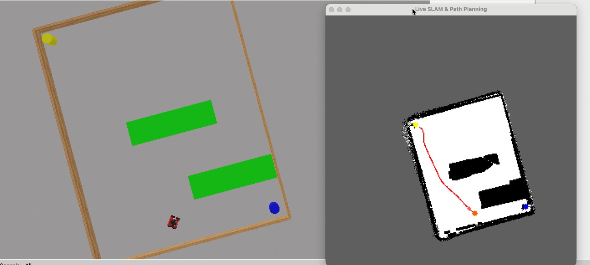

<div align="center">

# Autonomous ROSbot Maze Navigation in Webots

**A four-wheel ROSbot explores unknown mazes with no map, finds the blue pillar and then the yellow pillar, and avoids green floor hazards and raised wooden planks that its LiDAR cannot see.**

[](https://cyberbotics.com/)
[](#setup)
[](#perception)
[](LICENSE)

[📄 Report (PDF)](docs/report.pdf) ·
[🎬 Full run videos](https://drive.google.com/drive/folders/1NvmL1ATCnpO4yF6ab3tLbMCFY3grwadr?usp=sharing) ·
[🤖 Controller code](controllers/rosbot_python_controller)

*Autonomous Robotics · M.Sc. Artificial Intelligence for Industrial Applications ·
OTH Amberg-Weiden · Supervisor: Prof. Dr. Thomas Nierhoff · Summer Semester 2026*

</div>

---

## Demo

<p align="center">
  
  
</p>
<p align="center"><sub>Maze 4 (left) and Maze 5 (right), sped up. Left of each clip: the Webots scene. Right: the robot's live occupancy grid
(white = free, black = obstacle, red = planned A* path, orange = robot, blue/yellow = pillar estimates).</sub></p>

## Results

| Maze | Start → Blue | Blue → Yellow | Total |
|:---:|:---:|:---:|:---:|
| 1 | 01:39 | 01:00 | **02:39** |
| 2 | 01:48 | not recorded | — |
| 3 | 00:40 | 00:26 | **01:06** |
| 4 | 00:57 | 00:58 | **01:55** |
| 5 | 00:34 | 00:20 | **00:54** |

Times are mm:ss from single recorded runs. The robot completed Mazes 1, 3, 4 and 5 end to end. For Maze 2 only the
first leg was timed. See the [report](docs/report.pdf) for details.

## The task

The robot starts in a maze it has never seen, with no map. It has to:

1. **Find and reach the blue pillar**, then **find and reach the yellow pillar**.
2. **Never cross green floor regions** (hazards).
3. **Avoid raised wooden planks.** They sit above the 2D LiDAR's scan plane, so the LiDAR sees straight
   underneath them, yet they are low enough to hit the robot's body.

## How it works



### Localisation
Dead reckoning: the average displacement of the front wheel encoders is combined with the heading from the IMU
compass. There is no scan matching or loop closure, so the estimate can drift over long runs.

### Mapping
A **300 × 300 log-odds occupancy grid** covers 10 m × 10 m (about 3.3 cm per cell). Bresenham rays mark the cells
they pass through as free (−0.3) and the endpoint cell as occupied (+0.8), with values clipped to ±5. Map writes
pause while the robot turns quickly, which avoids smeared walls. Cells the robot has already driven over are kept
free.

### Perception
| Feature | How it is handled |
|---|---|
| Floor-standing walls | 360° LiDAR → occupancy grid |
| **Raised wooden planks** | Depth points kept only between **0.07 m and 0.20 m** above the floor (the robot-body band), plus wood-colour HSV segmentation. A point is used only if the LiDAR did *not* see it, then it is stamped into the grid |
| Green hazards | HSV segmentation → sampled pixels projected through depth into world coordinates → marked as obstacles. If green is close ahead, the robot turns away |
| Blue / yellow pillars | HSV masks + percentile depth → world position, smoothed with an EMA (α = 0.15) and frozen within 2 m |

### Planning and control
- **Frontier exploration:** connected frontier clusters are scored by size and distance. If no frontier is
  found, the robot picks a random waypoint.
- **A\*** (8-connected) on an inflated grid, with extra cost for unknown cells and cells close to walls. The
  inflation radius falls back from 4 to 2 cells when no path fits. The path is smoothed with a cubic **B-spline**.
- **Look-ahead PID steering** (K<sub>p</sub>, K<sub>i</sub>, K<sub>d</sub> = 6.0, 0.1, 1.5). Speed drops for
  large heading errors and near the target.
- **Recovery:** back-up and turn on collision (checking the rear sensors), escape after repeated low progress,
  turn away from green, and detour or relocate when no path to a pillar exists.

### Mission state machine
`SEARCHING_BLUE → GOING_TO_BLUE → SEARCHING_YELLOW → GOING_TO_YELLOW`, plus `DETOUR_BLUE` / `DETOUR_YELLOW`
when a route fails. Within 0.7 m of a visible pillar the robot skips A\* and drives straight at it.

<p align="center">
  
</p>

## Repository structure

```
.
├── controllers/
│   └── rosbot_python_controller/
│       ├── rosbot_python_controller.py   # main loop + mission state machine + recovery
│       ├── robot_controller.py           # Webots devices, odometry, LiDAR/depth obstacle points
│       ├── vision.py                     # HSV segmentation: pillars, green, wood
│       ├── map_manager.py                # log-odds grid, frontiers, live map display
│       ├── planner.py                    # A* + B-spline smoothing
│       ├── pid.py                        # steering PID
│       └── constants.py                  # all tunable parameters
├── worlds/                               # Maze1.wbt … Maze5.wbt
├── protos/                               # WallShort / WallMedium / WallLong
├── docs/
│   ├── report.pdf                        # project report
│   ├── figures/                          # report figures
│   └── media/                            # demo GIFs
├── requirements.txt
├── CITATION.cff
└── LICENSE
```

## Setup

1. Install **[Webots R2025a](https://cyberbotics.com/)**.
2. Install the Python dependencies into the interpreter that Webots uses:

   ```bash
   pip install -r requirements.txt
   ```

   To choose that interpreter, go to *Tools → Preferences → Python command*.
3. Clone the repository:

   ```bash
   git clone https://github.com/SomanthaManuranga/webots-rosbot-maze-navigation.git
   ```

## Running

1. In Webots, open one of `worlds/Maze1.wbt` … `worlds/Maze5.wbt`.
2. Start the simulation. Every world already uses the `rosbot_python_controller` controller.
3. A **"Live SLAM & Path Planning"** window opens with the occupancy grid, the planned path and the pillar
   estimates. The console logs each state change.

### Per-maze tuning

`constants.py` holds the shared configuration as submitted (for example `BASE_NAV_SPEED = 6.0`,
`PURE_PURSUIT_LOOKAHEAD = 15`, `INFLATION_RADIUS = 4`, `ASTAR_REPLAN_INTERVAL = 15`). For the recorded runs, a few
parameters were tuned per maze:

- **Speed:** higher in the open Mazes 3 and 5.
- **Look-ahead:** shorter in the tight zig-zags of Maze 4.
- **A\* inflation fallback and floating-wall range:** adjusted for Maze 2.
- **Approach point:** an offset for the blue pillar in Maze 3.

See Section 1.5 of the [report](docs/report.pdf). To reproduce a specific maze, edit those constants before
starting the simulation.

## Limitations

- Odometry only, so the map can drift over long runs. Scan matching or loop closure would fix this.
- The HSV colour thresholds and several navigation constants are hand-tuned and sensitive to the maze.
- Each maze has a single recorded run, with no repeated trials or success rates.
- There is no controlled comparison against a LiDAR-only version of the system.
- The smoothed B-spline path is not re-checked for collisions; live obstacle checks and replanning cover this.

## Citation

```bibtex
@misc{webots_rosbot_maze_2026,
  title        = {Autonomous ROSbot Maze Navigation in Webots},
  author       = {Manuranga, Somantha and others},
  year         = {2026},
  howpublished = {Autonomous Robotics project, OTH Amberg-Weiden},
  url          = {https://github.com/SomanthaManuranga/webots-rosbot-maze-navigation}
}
```

## License

The code is released under the [MIT License](LICENSE). The maze worlds and wall PROTOs were provided as part of
the course. The ROSbot model and the appearance PROTOs come from [Webots](https://github.com/cyberbotics/webots)
(Apache 2.0).
